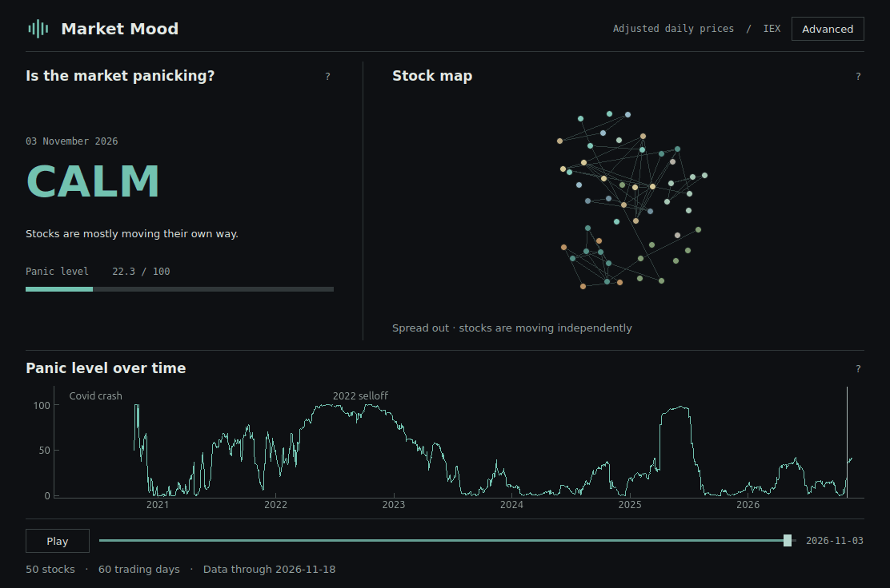

# Market Mood

[](.github/workflows/ci.yml)
[](LICENSE)
[](pyproject.toml)
[](.github/workflows/security.yml)

**See when a basket of stocks starts behaving like one stock.** Market Mood is a native desktop app for Windows and Linux with a terminal fallback.



One dot represents one stock. As stocks move together more often, their dots draw inward. A reading of 90 means the basket's strongest shared move accounted for more variation than in about nine out of ten earlier windows. Stocks can move together on the way up, too.

| Panic level | Reading | What it means |
|---|---|---|
| Below 50 | CALM | Stocks are moving more independently than usual. |
| 50 through 80 | NERVOUS | Shared moves are becoming more prominent. |
| Above 80 | PANIC | One common move dominates compared with most earlier windows. |

## Open the desktop

Use Python 3.12 for the verified setup. A hardware-accelerated Qt desktop is recommended for playback. Start in the project directory.

**Linux**

```bash
python3.12 -m venv .venv
source .venv/bin/activate
python -m pip install -e .
python main.py
```

On Debian, Ubuntu and Mint, Qt's X11 backend needs `libxcb-cursor0`. If Qt reports a missing xcb platform dependency, install it with `sudo apt install libxcb-cursor0 libxkbcommon-x11-0`. Linux Secret Service requires an unlocked desktop keyring.

**Windows PowerShell**

```powershell
py -3.12 -m venv .venv
.\.venv\Scripts\python -m pip install -e .
.\.venv\Scripts\python main.py
```

**First run.** Open the timeline and paste both Alpaca keys into **Connect Alpaca**. The app stores them in Windows Credential Manager or Linux Secret Service. An existing compatible cache opens offline. On a headless machine, set `ALPACA_API_KEY` and `ALPACA_SECRET_KEY` in the process environment using your secret manager. The desktop and CLI do not read a plaintext key file. The checked-in `.env.example` contains variable names.

The initial basket is the 50 symbols already in [configs/app.yaml](configs/app.yaml). In **Advanced**, paste or edit symbols, or load a CSV with an optional `symbol` or `ticker` header. Apply the changes. **Re-download prices** requests adjusted daily IEX bars from January 1, 2018 through the current date. Available coverage depends on the feed and symbol. Offline startup shows the last available trading date.

## Explore a trading day

- Drag the date slider or press **Play**. The reading, chart marker and stock map follow the selected session. Hover over a dot to see its ticker and sector.
- Open **Advanced** to choose 20–250 trading days, a 0.1–0.9 link cutoff, or threshold, spanning-tree and all-links maps. The **Details** tab explains pair movement, the common factor and its noise baseline. Enter a date there to inspect its exact reading or see the coverage gap.
- Save the dashboard as PNG or export a sampled historical replay as GIF or MP4. MP4 needs an FFmpeg installation with H.264 support on PATH.
- Use the **?** beside each panel for a short explanation. The welcome page appears once per user profile.

[First launch](docs/figures/first-launch.png) · [Calm date](docs/figures/calm.png) · [March 2020 coverage](docs/figures/march-2020.png) · [Advanced drawer](docs/figures/advanced.png)

## Terminal

```bash
python main.py --cli
market-panic --date 2022-10-25
market-panic --tickers AAPL MSFT JPM XOM --window 40
market-panic --refresh
```

The terminal reads the same snapshot as the desktop. A missing date returns exit code 1. The checkout launcher, the installed `market-panic-detector --cli` command and the packaged executable accept the same CLI flags.

## Measured results

The supplied adjusted-close Parquet cache yielded **1,528** complete 60-session windows for the 50-stock basket, from October 20, 2020 through November 18, 2026. Its SHA-256 is `20f9d2111b19d63223c173bbb42c0e878d1a21ddf5d4404e74f50b309434b679`. The underlying feed attribution comes from the existing project. These results were recomputed locally.

| Selected session | Mean pair correlation | Leading eigenvalue | Share | Panic level |
|---|---:|---:|---:|---:|
| Nov 3, 2026 · CALM | 8.4% | 10.38 | 20.8% | 22.3 |
| Oct 25, 2022 · PANIC | 55.9% | 29.01 | 58.0% | 100.0 |
| Mar 23, 2020 · unavailable | — | — | — | — |

The calm example is the last cached session below 25. The 2022 example has the highest average pair correlation among that year's PANIC dates. The March 2020 cache has zero bars. Its screenshot shows **No reading**. With earlier IEX bars available, refresh the cache and run `market-panic --date 2020-03-23` to measure that session.

## Method

1. Align positive adjusted closes on observed sessions. Forward-fill up to three missing prices. Drop sparse or constant tickers and show their names. Omit windows that still contain gaps or constant returns.
2. Compute daily log returns. In each trailing window, calculate the Pearson correlation matrix, the mean of its off-diagonal pairs and its largest eigenvalue. Divide that eigenvalue by the number of stocks to obtain its share of variance.
3. Score the share against **earlier** valid windows, with half credit for ties. The first window starts at 50. The independent-noise upper edge is `(1 + sqrt(N/T))²`.
4. Cache the matrices, readings, spanning trees and three sets of coordinates together. The map uses fixed anchors derived from the first window. Each stock's average pair movement controls its distance from the center. A compact map illustrates that same measurement.

Survivorship, ticker changes, single-exchange coverage, missing sessions and forward-filled prices can affect results. The score measures unusual co-movement and cannot determine price direction or predict a crash. A short reference history produces coarse percentiles. This project is educational and is **not financial advice**. [Methodology](docs/theory.md) · [Alpaca historical bars](https://docs.alpaca.markets/us/reference/stockbars)

## Project tree

```text
market-panic-detector/
├── pyproject.toml, requirements.txt       Package metadata and pinned native dependencies
├── main.py, Makefile                     Source launcher and development targets
├── MarketPanicDetector.spec              Native executable packaging rules
├── README.md, LICENSE, CHANGELOG.md       Usage, MIT license and release notes
├── SECURITY.md, SECURITY_AUDIT.md         Reporting guidance and audit findings
├── .env.example, .gitignore              Credential names and local file exclusions
├── .pre-commit-config.yaml               Formatting and lint hooks
├── configs/                              YAML universe, window, cutoff and theme
├── data/{raw,interim,processed}/          Ignored research data areas with keep files
├── notebooks/                            Four executed illustrated studies
├── src/panic_detector/
│   ├── config.py, cli.py                  Configuration and terminal interface
│   ├── analysis.py, service.py            Numeric snapshot and caching workflow
│   ├── data/                             Alpaca, credentials, cleaning and validation
│   ├── features/                         Log returns and rolling correlations
│   ├── models/                           Eigenvalue, percentile and noise measures
│   ├── networks/                         Three network modes and fixed map anchors
│   ├── viz/                              Theme, rendering data and exports
│   └── app/                              Qt entry point, widgets, drawer and workers
├── tests/{unit,integration,fixtures}/     Math, offline, GUI, export and speed checks
├── docs/                                 Theory, architecture and migration mapping
│   └── figures/                          Captured native views and hero GIF
├── scripts/                              Download, benchmark, capture and build helpers
├── .github/workflows/                    Linux/Windows CI and push-time security scans
└── backend/, frontend/                   Existing optional web workstation
```

The live app stores prices and derived arrays under the user's platform cache directory. A source checkout can adopt the earlier `cache/alpaca_daily.parquet`. The original web application has its own setup and launchers. [Architecture and migration](docs/architecture.md) · [Web workstation](docs/web-workstation.md)

## Verify and package

```bash
python -m pip install -e ".[dev,research,web]"
make lint
make test
make security
python scripts/benchmark.py --check
python scripts/benchmark.py --check --gpu-readback
python scripts/capture.py
python scripts/build_exe.py
```

Benchmark a warmed cache on a visible desktop. The script times startup through the first usable timeline, then samples date changes including Qt event processing. GPU readback also waits for both OpenGL framebuffers. The check fails above 16 ms for any measured frame or at 2 seconds for startup. Actual presentation cadence depends on OS scheduling, the display and GPU. The regression test prepares an isolated 50-stock cache.

Local Linux X11 results using Qt 6.12.0, the supplied 50-stock cache and 120 date changes per mode with GPU readback.

| Map | Warm startup | Median frame | Slowest frame |
|---|---:|---:|---:|
| Threshold | 0.85 s | 5.80 ms | 12.23 ms |
| Spanning tree | 0.68 s | 5.30 ms | 13.51 ms |
| All links | 0.90 s | 6.00 ms | 12.86 ms |

Pass `--mode threshold`, `--mode mst` or `--mode weighted` to reproduce each run. The Linux application and executable were exercised locally. Windows CI is configured to run the tests, build and invoke the packaged CLI.

Build on the target OS. The executable and its accompanying libraries live in `dist/MarketMood/`. On Windows, run `MarketMood.exe`; on Linux, run `./MarketMood`. The folder is one distributable unit. The build includes the public YAML configuration. See [security findings](SECURITY_AUDIT.md) and [credential handling](SECURITY.md).

## Publish the existing checkout

This checkout already has Git history and the `feat/market-mood` branch. The commands below are for Bash or Git Bash with GitHub CLI and Gitleaks installed. They create a **private** GitHub repository under your authenticated account. Review the staged list, which also includes the pre-existing web project. The final command publishes the branch.

```bash
set -euo pipefail
git switch feat/market-mood
git add --all
git diff --cached --check
git diff --cached --stat
staged_tree=$(mktemp -d)
git checkout-index --all --prefix="$staged_tree/"
gitleaks dir --redact=100 "$staged_tree"
git diff --cached --no-ext-diff --no-color | gitleaks stdin --redact=100
gitleaks git --redact=100 --log-opts=--all
git commit -m "Build Market Mood native desktop and offline market analysis"
gh repo create market-panic-detector --private --source=. --remote=origin
git push --set-upstream origin feat/market-mood
```

## Roadmap

Sign the Windows distribution and validate it on a physical display, collect comparable playback measurements across GPUs, and extend historical comparisons when earlier IEX sessions are available.

## References

- Rosario N. Mantegna, 1999. Correlation-derived distances and the minimum spanning tree. [Hierarchical Structure in Financial Markets](https://arxiv.org/abs/cond-mat/9802256)
- Laurent Laloux, Pierre Cizeau, Marc Potters and Jean-Philippe Bouchaud, 2000. Empirical eigenvalues and random-matrix noise. [Random Matrix Theory and Financial Correlations](https://www.cfm.com/wp-content/uploads/2022/12/234-1999-random-matrix-theory-and-financial-correlations.pdf)
- Jean-Philippe Bouchaud and Marc Potters, 2003. Dependence and diversification in financial time series. [Theory of Financial Risk and Derivative Pricing](https://www.cambridge.org/core/books/theory-of-financial-risk-and-derivative-pricing/5BBBA04CE72ED9E5E7C1C028D9A94FCB/listing)
